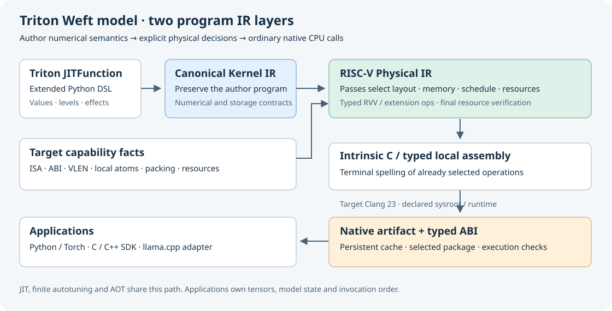
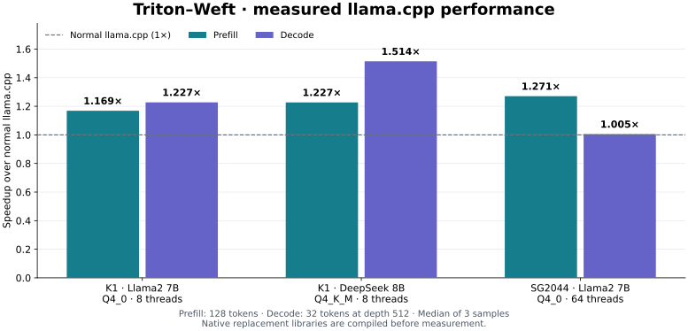

# Triton–Weft

[中文](README.zh-CN.md) · [Handbook](https://tianchen-ai.github.io/Weft/) ·
[Examples](third_party/weft/doc/getting-started/examples.md) ·
[Weft Bench](https://github.com/Tianchen-ai/Weft-Bench)

This source tree extends Triton 3.8.0 with `@triton.jit(model="weft")` for
structured, finite-width CPU programs. The shared Python frontend produces
Canonical Weft IR; the RISC-V physical pipeline emits intrinsic C and local
assembly for RVV and supported matrix extensions. JIT, autotuning, caching,
native artifacts and the Python package remain part of Triton.

Write familiar Triton tensor code for RISC-V CPUs, then use optional Encoding,
Level and finite-width operations when packed storage and data reuse need to be
part of the program. The compiler selects RVV operations and supported IME
matrix fragments while preserving those numerical and storage contracts.
Applications can launch CPU tensors directly or deploy compiled libraries into
an existing C/C++ thread pool, including llama.cpp.

The standard Triton GPU compilation routes are retained. Native x86/AMX and
TileLang integration are future backend/frontend work.



## Build and install

Build this checkout in a dedicated Python environment. A normal upstream
`pip install triton` does not include the Weft extension.

```sh
python -m venv /path/to/environment
/path/to/environment/bin/python -m pip install -r python/requirements.txt
CC=/path/to/matched-llvm-sdk/bin/clang \
CXX=/path/to/matched-llvm-sdk/bin/clang++ \
LLVM_SYSPATH=/path/to/matched-llvm-sdk \
TRITON_WEFT_CLANG_ROOT=/path/to/native-clang-23 \
TRITON_WEFT_OPENMP_LIBRARY=/path/to/libomp.so \
TRITON_WEFT_OPENMP_INCLUDE_DIR=/path/to/openmp-headers \
TRITON_BUILD_DIR=/path/to/build \
TRITON_BUILD_PROTON=OFF \
/path/to/environment/bin/python -m pip install --no-build-isolation .
```

Use the LLVM revision in [cmake/llvm-info.json](cmake/llvm-info.json).
The [installation guide](third_party/weft/doc/getting-started/installation.md)
covers bundled Clang/OpenMP, RISC-V native wheels, cross compilation and the
PyTorch source integration. Install one Triton distribution per environment.

## Write, compile and run

```python
import numpy as np
import triton
import triton.language as tl

@triton.jit(model="weft")
def affine(X, Y, N, scale, B: tl.constexpr):
    offsets = tl.program_id(0) * B + tl.arange(0, B)
    active = offsets < N
    x = tl.load(X + offsets, mask=active, other=0.0)
    tl.store(Y + offsets, x * scale, mask=active)

x = np.arange(131, dtype=np.float32)
y = np.empty_like(x)
affine[(triton.cdiv(x.size, 64),)](x, y, x.size, 1.25, B=64, num_cpu_threads=2)
print(y[:8])
```

Save the kernel in a Python file and run it on a supported RISC-V host.
Grid size and OpenMP thread count are independent. Masked-off lanes do not
access memory. Standard `tl.dot(a, b, acc)`, reductions, inclusive scans and
pointer atomics use Triton's language entry points; explicit View/Encoding/Level
constructs add the Weft programming model.

See the [runnable quickstart](third_party/weft/doc/getting-started/quickstart.md)
for a complete kernel. `CompiledKernel.asm` exposes `weftir`, `riscvir`, `c`
and `so`; `CompiledKernel.export` and `triton.Package.create` provide native
artifacts for Python, C/C++ and llama.cpp. CPU tensors use the same JIT launch.

The [example guide](third_party/weft/doc/getting-started/examples.md) covers
pointwise code, row softmax, matmul, scan, histogram, autotuning, native export,
PyTorch and the existing quantized/model programs. For example:

```sh
PYTHONPATH=third_party/weft python -m examples.triton_basics --operation softmax
PYTHONPATH=third_party/weft python -m examples.triton_basics --operation histogram
PYTHONPATH=third_party/weft python -m examples.autotune_export /path/to/new/artifact
```

## Documentation

- [Weft language and compiler handbook](third_party/weft/doc/index.md)
- [Encoding, View and storage](third_party/weft/doc/dsl/encoding-and-artifacts.md)
- [Level and value lifetimes](third_party/weft/doc/dsl/values-and-levels.md)
- [JIT, autotune and runtime](third_party/weft/doc/compiler/runtime.md)
- [PyTorch and application integration](third_party/weft/doc/integrations/overview.md)
- [Native SDK and llama.cpp](third_party/weft/doc/compiler/native-sdk.md)
- [Target extension contracts](third_party/weft/doc/development/extensions.md)
- [Contributing](CONTRIBUTING.md)

Correctness and performance measurements use the independent Weft Bench;
this repository contains the compiler, runtime and application examples.

PyTorch graph integration uses the supported Triton HOP/Inductor interfaces
described in the installation guide. Install its source seam once with
`python -m triton.tools.pytorch`; kernels still use ordinary Triton launches and
`torch.compile(..., options={"cpu_backend": "triton"})`.

## Measured application performance



These are measured **normal llama.cpp → native replacement package** comparisons,
with prefill and decode timed separately. They are not extrapolated from operator
microbenchmarks. DeepSeek 8B decode on K1 reaches **1.514×**; SG2044 Llama2 decode
is **1.005×**, showing where the current replacement set adds little benefit.

The workloads use Llama2 7B Q4_0 and DeepSeek-R1-Distill-Llama 8B Q4_K_M:
128 prompt tokens for prefill; 32 generated tokens at depth 512 for decode;
8 threads on K1 and 64 on SG2044; median of 3 samples. Native libraries are
compiled and loaded before timing. Replacement counters confirm the invoked
roles. Separate 16-token fixed-prompt checks compare the full-vocabulary logits at the
last prefill token and two teacher-forced decode steps with `atol=rtol=1e-3`.
The fixed llama.cpp build uses Clang 18; exported Weft kernels use Clang 23.
These application gains include that toolchain choice.

Results describe these exported artifacts, models and workloads, not every
RISC-V machine or model. The independent [Bench project](https://github.com/Tianchen-ai/Weft-Bench)
owns workload definitions, normal GGML/llama.cpp baselines and reproduction.
Native operator, grid launch, Python call and model timings remain separate.

## Upstream and licensing

[Triton](https://github.com/triton-lang/triton/tree/v3.8.0) supplies the shared
frontend, JIT, compiler infrastructure and GPU backends. Its
[official documentation](https://triton-lang.org/) describes the standard model.
The original research is [Triton: An Intermediate Language and Compiler for
Tiled Neural Network Computations](https://doi.org/10.1145/3315508.3329973).

Triton retains its MIT license; the Weft compiler and migrated modules retain
Apache-2.0. [NOTICE](NOTICE) identifies component ownership and third-party
licenses. The extension is maintained in this repository; upstream ownership
and release procedures do not apply automatically.
