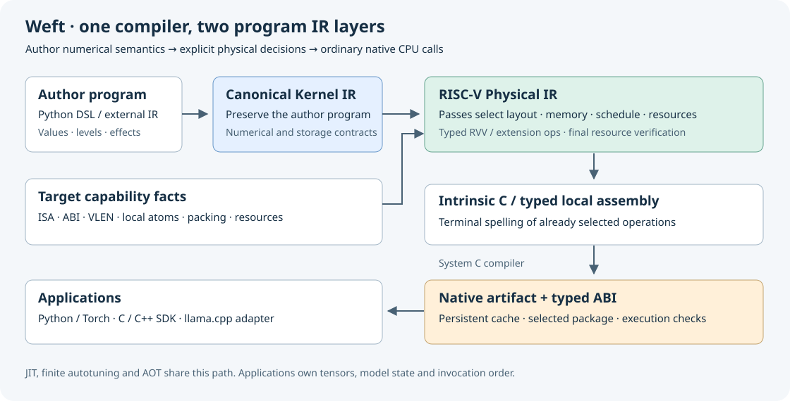

# Weft

**面向 RISC-V 的数值 kernel 语言与编译器。**

采用 [Apache-2.0](LICENSE) 许可证。

[English](README.md) · [安装](doc/getting-started/installation.md) ·
[快速上手](doc/getting-started/quickstart.md) · [框架接入](doc/integrations/overview.md) ·
[工具书](https://tianchen-ai.github.io/Weft/) · [参与贡献](CONTRIBUTING.md)

Weft 让开发者用 Python DSL 编写数值程序，生成 RVV 及已支持局部扩展的原生 kernel，
通过 Python、PyTorch 或 C/C++ 调用。目标是让 RISC-V 算子开发获得类似 Triton 的
编程体验，同时保留普通 CPU 有序程序与 RISC-V 模块化能力的清晰边界。

Canonical Kernel IR 保存作者确定的数值程序；RISC-V Physical IR 中的 passes 决定
布局、访存、调度、资源和局部指令。最后翻译为 intrinsic C / typed local asm，交给系统编译器。



## 可以使用的能力

| 入口 | 用途 |
|---|---|
| `weft.jit` / `weft.compile` | 原生编译、类型化调用、跨进程 artifact 缓存、prepared call |
| `weft.autotune` | 有限候选、数值检查、隔离试跑状态、持久选择结果 |
| `weft.programs` | Norm、RoPE、attention、投影、MoE、Mamba-1 与完整模型 block |
| `weft.torch` | CPU Tensor 零拷贝、custom operator、fake/meta、作者 backward、图捕获与导出 |
| 构建与离线包 | 可检查的 IR/C/ABI，显式跨机部署，固定配置的 kernel 包 |
| C/C++ SDK | 类型化参数、存储生命周期、prepared call 与有序原生 sequence |
| llama.cpp adapter | 在正常 GGML CPU 路径中替换显式注册的 vec-dot |

公开模型库以 **f32 inference** 为主要合同，量化 kernel 通过独立的 Encoding 合同与源码库提供。
Python 要求 3.10+。原生执行要求 little-endian RISC-V Linux、可用的 RVV 和兼容的 C 工具链；
当前真机验证目标是 SG2044（VLEN 128）和 K1（VLEN 256）。开发主机可以只生成 RISC-V 产物。

## 安装

先安装 CMake 3.20+、Ninja、C++17 编译器和同一安装内的 LLVM/MLIR SDK。
目前构建参考使用 LLVM 20。假设完整 SDK 位于 `/usr/lib/llvm-20`：

```sh
git clone https://github.com/Tianchen-ai/Weft.git
cd Weft
python3 tools/install.py --environment /tmp/weft-env \
  --llvm-root /usr/lib/llvm-20 --build-dir /tmp/weft-build --jobs 4
. /tmp/weft-env/bin/activate
python -m pip install numpy
weft --help
```

安装器生成包含 Python API、编译器和 SDK 的本机 wheel。目标机上进行 JIT 还需要能编译
RVV intrinsic 的 C 编译器。完整步骤、工具链参数与常见错误见[安装指南](doc/getting-started/installation.md)。
这个入口直接从源码安装，不依赖 PyPI 上已经发布某个版本。

## 第一个算子

在 RISC-V 机器上选择本机 C 编译器并查询实际目标：

```sh
export CC=clang
weft target
```

```python
import numpy as np
from weft.programs import Operators

x = np.linspace(-1, 1, 387, dtype=np.float32).reshape(3, 129)
weight = np.ones(129, dtype=np.float32)
with Operators() as operators:
    y = operators.rms_norm(x, weight)
expected = x / np.sqrt(np.mean(x * x, axis=-1, keepdims=True) + 1e-5)
np.testing.assert_allclose(y, expected, rtol=2e-3, atol=1e-4)
print(y.shape)
```

首次调用编译，后续调用复用；完整产物也能跨进程缓存。[快速上手](doc/getting-started/quickstart.md)
继续说明如何写自己的 DSL、调优、保存产物和检查生成代码。

没有 RISC-V 机器时，可以在开发主机观察两层 IR 与 C：

```sh
weft build --kernel weft.programs.normalization:rms_norm --meta BLOCK=64 \
  --march rv64imafdcv --abi lp64d --vlen-bits 128 \
  --source-only --output /tmp/weft-rms-artifact
weft inspect /tmp/weft-rms-artifact --emit operations --format text
```

保存路径必须尚不存在。生成成功只说明到达对应 artifact 边界，数值结论仍需在目标机器上运行。

## 接入、性能与边界

[框架指南](doc/integrations/overview.md)覆盖 Torch、模型 block、离线 SDK 和 llama.cpp；
[扩展指南](doc/development/extensions.md)说明新增 RISC-V 扩展需要补齐的 capability、局部 op、
physical selection、emission 与原生发现合同。

使用现有数值示例与[测量合同](doc/development/validation.md)评估实际工作负载。比较时核对
target、输入、dtype、工具链、作者程序和计时范围；调用开销、kernel 耗时与模型吞吐分别记录。

目前适合开发者使用与参与贡献，但仍需明确以下边界：

- 收益依赖算子、shape、作者版本与目标，不承诺普遍超过 GGML 或厂商实现。
- Torch 集成是 opaque CPU operator，不自动把任意 Torch 图翻译为 Weft；模型模块不自动求导。
  图捕获与导出已有路径，Inductor 性能尚未建立结论。
- ISA 名称不能代替局部指令实现、资源合同和执行权限探测；具体扩展以 capability 查询为准。
- llama.cpp 接口覆盖注册的单行 vec-dot ABI，原有 repack/IME 与线程池仍由上游选择；
  不能据此宣称覆盖所有矩阵路径或已取得模型级加速。

## 参与贡献

[贡献指南](CONTRIBUTING.md)说明构建、现有 repro、编译器职责与修改所需证据。
可以用中文或英文提交 [issue](https://github.com/Tianchen-ai/Weft/issues)；请提供最小 kernel、
实际 target 和工具链。安全问题见 [SECURITY.md](SECURITY.md)，第三方说明见
[THIRD_PARTY_NOTICES.md](THIRD_PARTY_NOTICES.md)。
